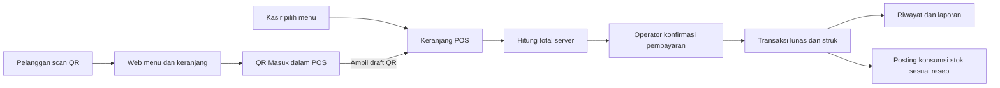

# PRODUCT REQUIREMENTS DOCUMENT (PRD)
## Smart POS F&B | Waroeng MeJeng Kampoeng

| Metadata | Isi |
|---|---|
| Versi | **2.1 – Single Operator MVP Tanpa ML** |
| Tanggal | 26 Oktober 2026 |
| Status | Spesifikasi pembangunan; data transaksi, harga, resep, dan tarif yang tampil pada mockup adalah **simulasi** |
| Platform operasional | **Flutter Android, tablet landscape utama, dapat dipakai di HP** |
| Antarmuka pelanggan | Web responsif dibuka dari QR meja (tanpa login dan tanpa instal aplikasi) |
| Cakupan | **Satu UMKM, satu lokasi, satu operator kasir merangkap pemilik** |
| Rencana teknis | Flutter; Vue.js untuk QR; Supabase (Auth, PostgreSQL, Storage, Realtime); API transaksi; tidak ada layanan ML untuk MVP |
| Dokumen pendamping | `Sprints.md`, `index.html` (mockup interaktif) |

> **Keputusan final revisi:** hanya **satu pengguna internal** mengoperasikan keseluruhan aplikasi. **Tidak ada modul Dapur, Kitchen Display, akun staf, pembagian role, halaman Pesanan, antrean tahap masak, konfirmasi dapur, atau pengelolaan banyak cabang/tenant.** Seluruh alur dipegang pada **satu layar Kasir POS**. Riwayat penjualan tetap tersedia, karena diperlukan untuk audit dan laporan. Fitur QR pelanggan tetap dipertahankan, tetapi keranjang yang dikirim dari QR ditampilkan sebagai **QR Masuk di dalam POS**, bukan pada halaman Pesanan terpisah.

---

# 1. Ringkasan Produk

Aplikasi kasir pribadi untuk Waroeng MeJeng Kampoeng, usaha makanan/minuman di Kalumbuk, Kuranji, Padang. Operator membuka POS pada tablet, menambahkan menu ke keranjang, menerima input dari QR pelanggan, menghitung total, menerima pembayaran, mengeluarkan struk, dan meninjau ringkasan transaksi. Di bagian pengelolaan yang sama operator mengatur menu/harga, stok, resep/HPP, pembelian, listrik, LPG, air, biaya operasional, kas, analitik, dan nantinya prakiraan penjualan.

## 1.1 Masalah yang diselesaikan

- Pencatatan dan kalkulasi transaksi manual berisiko salah jumlah, diskon, dan kembalian.
- Harga makanan/minuman dan topping berubah, sementara riwayat nilai penjualan harus tetap konsisten.
- Belanja bahan dan pemakaian bahan per menu sulit dipantau tanpa resep dan ledger stok.
- Listrik, gas, air, kemasan, dan overhead sering belum masuk dalam evaluasi biaya usaha.
- Riwayat transaksi belum tentu tersedia secara digital; MVP harus mencatat data yang benar untuk laporan sekarang dan potensi riset nanti.

## 1.2 Ukuran keberhasilan yang harus diuji

| Metrik | Target uji pilot (bukan klaim tercapai) |
|---|---|
| Akurasi perhitungan | 100% kasus unit test total, diskon, uang bayar, kembalian dan pembulatan |
| Duplikasi transaksi | 0 duplikasi pada skenario 100 retry idempotency key identik |
| Transaksi POS | Dapat diproses dengan tangan pada tablet 10–11 inci, tanpa navigasi kompleks |
| Alur QR → POS | Draft QR terlihat pada POS setelah refresh/realtime, tidak dianggap terbayar sebelum checkout |
| Riwayat | Transaksi lunas, refund, dan nilai historis tidak berubah saat harga menu diedit |
| HPP dan biaya | Tiap hasil dapat ditelusuri ke resep/tarif/alokasi, estimasi diberi label |
| Keamanan | Pengunjung QR tidak dapat membaca data internal/keuangan |
| Dashboard aktual | Seluruh angka hanya dari transaksi, stok, dan biaya yang tersimpan; tanpa angka prediksi atau AI fiktif |

# 2. Cakupan dan Non-Scope

## 2.1 Dalam cakupan

1. Aplikasi satu akun internal dengan dashboard yang menyatukan semua fungsi.
2. POS kasir berbasis tablet/HP; katalog menu dan keranjang di layar yang sama.
3. QR pelanggan → web menu → keranjang → kirim → **QR Masuk di dalam layar POS** → kasir mengambil → pembayaran.
4. Katalog menu, foto, kategori, harga adjustable, varian, topping, status tersedia/habis, dan promo.
5. Kalkulasi otomatis subtotal, diskon, komponen pajak/layanan bila diterapkan, total, nominal dibayar, kembalian.
6. Pembayaran tunai dan pencatatan transfer/QRIS **manual yang diverifikasi operator**; struk digital dan printer jika kompatibel.
7. Penjualan dan riwayat transaksi yang dapat dicari, refund/void dengan alasan.
8. Manajemen bahan, resep/BOM, pembelian, penyesuaian/waste, stok dan HPP.
9. Alat dan biaya operasional: listrik, LPG, air, kemasan, sewa dan overhead.
10. Kas awal/akhir shift dan rekonsiliasi.
11. Dashboard, grafik, laporan; ekspor CSV prioritas awal dan PDF/XLSX fase lanjutan.
12. Dashboard analitik **deskriptif**, menampilkan data aktual dan kalkulasi deterministik. ML **tidak termasuk MVP**.

## 2.2 **Tidak dibangun**

- Role `Owner/Kasir/Dapur`, pendaftaran pegawai, multi-user internal dan matriks izin antarstaf.
- Halaman `Pesanan`, `Order Management`, `Kitchen Board`, `Kitchen Queue`, status `PREPARING/READY/SERVED`.
- SaaS, multi-tenant, multi-outlet, subscription, dan login lintas usaha.
- Aplikasi pelanggan native.
- Otomasi produksi/dapur dan pemotongan stok dari event status dapur.
- Penerimaan QRIS yang dianggap otomatis sukses hanya dari gambar QR; perlu PSP untuk verifikasi otomatis.
- Pembelian bahan otomatis tanpa persetujuan operator, prediksi ML, rekomendasi berbasis model, training dan inference ML, FastAPI model, serta halaman AI Insights pada MVP.

# 3. Persona dan Hak Akses

| Aktor | Akses | Autentikasi |
|---|---|---|
| **Operator tunggal** | Semua modul MVP: POS, dashboard, menu, QR, biaya, HPP, stok, laporan, pengaturan | Satu akun terlindungi (Supabase Auth/PIN lokal sebagai unlock tambahan jika diperlukan) |
| **Pelanggan QR** | Hanya menu publik, varian, keranjang, dan pengiriman draft ke POS | Tidak login; token QR meja yang dapat dirotasi |

Operator tetap membutuhkan login karena menyimpan informasi pembayaran dan biaya internal. Ini **bukan** sistem role management. Identitas internal tetap dicatat dalam audit teknis satu akun.

# 4. Informasi Arsitektur dan Navigasi

## 4.1 Daftar halaman internal

| ID | Halaman | Konten yang harus ada |
|---|---|---|
| SCR-01 | **Dashboard** | Omzet diterima, transaksi lunas, jumlah QR masuk, stok kritis, shortcut POS |
| SCR-02 | **Kasir POS** | Katalog + pencarian + kategori, keranjang aktif, tab **QR Masuk** di **layar yang sama**, meja/takeaway, checkout |
| SCR-03 | **Pembayaran (sheet/modal POS)** | Rincian final, diskon, pajak/layanan, tunai/non-tunai, uang diterima, kembalian, simpan transaksi |
| SCR-04 | **Menu & Harga** | CRUD, foto, harga, varian, topping, promo dan ketersediaan |
| SCR-05 | **Meja & QR** | Meja terdaftar, kode/link unik, QR yang bisa dirotasi; tombol coba menu pelanggan |
| SCR-06 | **Stok Bahan** | Master, satuan, saldo, batas minimum, mutasi, penyesuaian dan waste |
| SCR-07 | **Resep & HPP** | Bahan/menu, kuantitas, HPP bahan, margin perkiraan, biaya per batch |
| SCR-08 | **Pembelian** | Barang, jumlah, harga, tanggal, penerimaan stok |
| SCR-09 | **Biaya Operasional** | Daftar expense aktual/estimasi termasuk listrik, LPG, air, sewa, kemasan |
| SCR-10 | **Kalkulator Energi** | Watt, jam, duty factor, tarif; LPG, porsi, biaya per porsi, simpan estimasi |
| SCR-11 | **Kas Shift** | Kas awal, transaksi tunai, pengeluaran kas, kas terhitung, kas nyata, selisih |
| SCR-12 | **Riwayat & Struk** | Daftar penjualan final, detail snapshot, refund, unduh/cetak struk |
| SCR-13 | **Laporan** | Harian/bulanan, grafik pendapatan, HPP bahan, overhead, margin dan ekspor |
| SCR-14 | **Pengaturan** | Usaha, tarif, pajak/layanan, perangkat/backup dan reset demo (hanya mockup) |
| WEB-01 | **QR Menu Pelanggan** | Produk, variasi, keranjang, identitas meja, kirim ke kasir; tanpa halaman pelacakan dapur |

**Bottom navigation HP:** Dashboard, Kasir, Stok, Laporan, Lainnya. **Tablet landscape:** sidebar ringkas kategori modul; di POS area katalog dan keranjang berdampingan. Tidak ada role selector atau halaman operasional lain untuk operator.

## 4.2 Diagram alur minimum



Saat QR dikirim, **belum ada transaksi berbayar**. Draft QR bersifat sementara dan tidak masuk omzet, kas, konsumsi bahan atau data penjualan aktual sampai kasir menyelesaikan transaksi. Pada halaman POS kasir dapat memilih satu draft QR dan membukanya sebagai keranjang aktif; jika keranjang sebelumnya berisi item, kasir harus mengosongkan/menyimpan draft sebelum mengganti agar data tidak diam-diam bergabung.

# 5. Persyaratan Fungsional dan Acceptance Criteria

| ID | Prioritas | Fitur | Acceptance criteria |
|---|---|---|---|
| FR-01 | P0 | Akun operator tunggal dan sesi aman | Pengunjung tanpa sesi tak dapat membaca POS/laporan; logout menutup akses data privat |
| FR-02 | P0 | Profil usaha | Nama, lokasi, informasi struk, jam buka, timezone WIB dapat diperbarui |
| FR-03 | P0 | Menu/kategori/foto/arsip | Item tidak tersedia tidak dapat ditransaksikan, transaksi lama tidak terhapus |
| FR-04 | P0 | Modifier, varian, catatan | Harga akhir modifier benar, batas pilihan divalidasi di server |
| FR-05 | P0 | Adjustable pricing | Edit harga tercatat; nilai transaksi sebelumnya tidak berubah |
| FR-06 | P0 | QR meja | Meja punya token sulit ditebak, bisa dicabut; menu pelanggan hanya membuka data publik |
| FR-07 | P0 | POS layar tunggal | Katalog, keranjang, **QR Masuk** dan tombol bayar tersedia tanpa ke halaman pesanan |
| FR-08 | P0 | QR submit draft | Satu submit/ulang request idempotent menghasilkan satu draft; draft belum dihitung sebagai penjualan |
| FR-09 | P0 | Ambil draft QR | Operator dapat mengambil draft ke keranjang POS; tidak muncul alur dapur |
| FR-10 | P0 | Server-side Auto Calculate | Harga diambil dari snapshot server; subtotal, diskon, pajak, biaya layanan dan total tepat |
| FR-11 | P0 | Pembayaran | Kembalian hanya tunai; transfer/QRIS manual memerlukan verifikasi operator |
| FR-12 | P0 | Penjualan final dan struk | Satu checkout hanya satu sale, immutable item snapshot, ID unik |
| FR-13 | P0 | Refund/void | Koreksi tercatat sebagai event/ledger, tidak menghapus histori |
| FR-14 | P0 | Kas shift | Saldo kas dari transaksi tunai saja; dapat dibandingkan uang nyata |
| FR-15 | P0 | Stok satuan | Gram, kg, ml, liter, pcs konversi jelas dan ada ledger stok |
| FR-16 | P0 | Resep dan HPP | Bahan/qty/yield per menu; estimasi biaya terhitung dari harga beli valid |
| FR-17 | P0 | Stok dari transaksi final | Posting tepat sekali sesuai kebijakan: jika diproses per transaksi, sekali pada checkout final; waste dicatat terpisah |
| FR-18 | P0 | Pembelian dan koreksi | Penambahan/pengurangan stok memiliki alasan dan waktu |
| FR-19 | P0 | Listrik/LPG/air/overhead | Input daya dan durasi, tarif, label estimasi/aktual, biaya per batch/porsi |
| FR-20 | P0 | Alokasi biaya | Tidak boleh ada dua kali pemotongan overhead atau alokasi melebihi biaya sumber |
| FR-21 | P0 | Dashboard & laporan | Omzet hanya penjualan benar-benar final setelah adjustment/refund menurut definisi jelas |
| FR-22 | P1 | Ekspor dan struk printer | Ekspor angka cocok dengan layar, cetak ulang tidak menambah transaksi |
| FR-23 | P1 | Offline POS terbatas | Retry/sinkronisasi aman tanpa duplikasi; QR tetap online |
| FR-24 | P0 | Empty/error/loading state | Kondisi data nol, invalid, jaringan putus, dan retry ditampilkan jelas |

# 6. Aturan Perhitungan

## 6.1 Total transaksi

```text
harga_item = harga_aktif_snapshot + harga_modifier_snapshot
subtotal = SUM(harga_item × jumlah)
diskon = hasil aturan diskon tervalidasi (Rp integer)
dasar_pajak = subtotal - diskon + komponen tertentu sesuai aturan usaha
pajak = ROUND(dasar_pajak × tarif yang diterapkan)
biaya_layanan = jumlah sesuai kebijakan
TOTAL = subtotal - diskon + pajak + biaya_layanan
kembalian_tunai = MAX(0, nominal_diterima - TOTAL)
```

- Harga, pajak, dan komponen layanan adalah konfigurasi **bukan asumsi otomatis**. Aturan pajak sesuai kondisi usaha harus dikonfirmasi.
- Uang disimpan sebagai integer rupiah. Tidak mempercayai perhitungan browser/frontend sebagai sumber transaksi.
- Diskon/total final dicatat saat pembayaran. Transaksi lama tidak ikut berubah saat master harga diedit.
- QR draft tidak mengunci harga selamanya: saat diambil kasir, backend validasi harga tersedia, menu aktif dan modifier. Jika berubah, operator diberi peringatan sebelum bayar.

## 6.2 HPP dan margin

```text
HPP_bahan_per_porsi = SUM(kebutuhan_bahan_terkonversi × biaya_per_satuan_dasar)
biaya_langsung_per_porsi = HPP_bahan + kemasan + energi_langsung_teralokasi
margin_kontribusi_per_porsi = harga_jual_bersih - biaya_langsung_per_porsi
estimasi_hasil_operasional = total_margin_kontribusi - overhead_periode_yang_belum_dialokasikan
```

Gunakan label **estimasi hasil operasional**, bukan laba bersih, sebelum tenaga kerja, sewa, penyusutan, dan kewajiban lainnya dimasukkan secara memadai. Produksi batch gorengan harus mengurangi bahan sekali saat batch dibuat, bukan sekali per batch dan lagi per penjualan.

## 6.3 Energi dan utilitas

```text
kWh_est = daya_watt × durasi_jam × faktor_beban / 1000
biaya_listrik_est = kWh_est × tarif_efektif_per_kWh
biaya_lpg_batch_est = (harga_isi_ulang / jam_efektif_tabung) × jam_pemakaian_batch
biaya_energi_per_porsi = biaya_energi_batch / jumlah_porsi_yang_benar
```

Tarif input operator, bukan tarif nasional yang dikode keras. Untuk kulkas/shared meter, estimasi berdasarkan watt konstan memiliki keterbatasan; gunakan nilai aktual meter/tagihan bila ada. Pisahkan biaya energi langsung (batch) dan overhead toko agar tidak terhitung dua kali. Semua asumsi disimpan dengan label dan sumber.

# 7. Struktur Data Inti (Satu Usaha)

| Entity/Tabel | Kolom penting | Aturan |
|---|---|---|
| `business_settings` | name, address, timezone, tax_config, service_config | Hanya satu record usaha |
| `products` | id, category_id, name, price, active, photo_url | Soft delete/arsip |
| `product_price_history` | product_id, old_price, new_price, effective_at, reason | Tidak mengubah histori sale |
| `modifiers` / `product_modifiers` | option, price_delta, min/max selection | Harga tervalidasi server |
| `dining_tables` | id, label, qr_token_hash, enabled | QR token dapat dirotasi |
| `qr_drafts` / `qr_draft_items` | id, table_id, public_ref, status, items_snapshot, expires_at | `PENDING/CLAIMED/EXPIRED/CANCELLED`; **bukan** penjualan |
| `sales` / `sale_items` | sale_id, origin, table, item_snapshot, totals, created_at | Dibuat saat kasir checkout final |
| `payments` / `refunds` | sale_id, method, amount, external_ref, status | Append-only finansial |
| `ingredients` | id, base_unit, balance, reorder_level, unit_cost | Qty presisi decimal |
| `recipe_versions` / `recipe_items` | product_id, ingredient_id, qty_per_yield | Versi & BOM |
| `stock_movements` | source, ingredient, qty_delta, reason, ref | Ledger, immutable |
| `purchases` / `purchase_items` | ingredient, qty, total, received_at | Penerimaan menambah stok sekali |
| `expenses` | type, amount, kind, source_ref, date | Aktual vs estimasi |
| `equipment` / `energy_estimates` | watt, duty, hours, tariff, batch_ref | Asumsi eksplisit |
| `cost_allocations` | expense_id, target_ref, amount | Hindari double count |
| `cash_shifts` | opening_cash, expected, actual, variance, closed_at | Satu shift terbuka |
| `audit_events` | event, user_id, ref_id, before, after, reason | Jejak koreksi, perubahan harga, refund |

**Tidak ada:** `tenants`, `branches`, `employees`, `kitchen_tickets`, `kitchen_status_events`, `staff_roles`.

# 8. Kontrak API Utama

| Method | Path rancangan | Tujuan |
|---|---|---|
| `GET` | `/v1/public/menu?table_token=...` | Daftar menu aktif pelanggan |
| `POST` | `/v1/public/qr-drafts` | Kirim keranjang QR; rate limit, token meja, idempotency |
| `GET` | `/v1/qr-drafts?status=PENDING` | Draft QR belum diambil, hanya operator |
| `POST` | `/v1/qr-drafts/{id}/claim` | Lock draft dan siapkan keranjang untuk POS |
| `POST` | `/v1/sales/quote` | Harga final tervalidasi sesuai master |
| `POST` | `/v1/sales/checkout` | Sale + payment + stok atomik; idempotency |
| `GET` | `/v1/sales` | Riwayat dan laporan penjualan |
| `POST` | `/v1/sales/{id}/refund` | Refund dan audit |
| `GET/POST/PATCH` | `/v1/products` | Menu dan harga dengan validasi sesi operator |
| `GET/POST` | `/v1/stock/movements` | Mutasi stok yang diaudit |
| `POST` | `/v1/expenses` | Pencatatan aktual/estimasi |
| `POST` | `/v1/energy/estimates` | Simpan perhitungan energi |
| `GET` | `/v1/reports/summary` | Statistik usaha |

Contoh QR draft (ilustrasi kontrak):

```json
{
  "table_token": "opaque-table-token",
  "client_request_id": "uuid-generated-on-device",
  "items": [{"product_id": 1, "qty": 2, "modifier_ids": [], "note": "Sambal terpisah"}]
}
```

Tidak terima `unit_price`, `payment_status: paid`, atau `total` dari browser sebagai otoritas transaksi. Endpoint QR hanya membuat draft.

# 9. Dashboard Aktual, Bukan Machine Learning

MVP **tidak membangun, melatih, menjalankan, atau menampilkan model ML/AI**. Produk harus selesai sebagai aplikasi POS yang dapat dipakai untuk transaksi nyata terlebih dahulu. Halaman `AI Insights`, endpoint `/v1/forecasts`, tabel `forecast_runs`, paket `ml_api`, dan library ML tidak termasuk deliverable.

**Analitik MVP yang diperbolehkan**:
- Omzet bersih dari penjualan final dikurangi refund sesuai definisi finansial.
- Jumlah transaksi final, rata-rata nilai transaksi, serta menu terlaris dari item yang benar-benar terjual.
- Penjualan per hari dan jam **historis**, bukan estimasi jam ramai masa depan.
- Jumlah/stok minimum bahan, nilai HPP dari resep yang terverifikasi.
- Biaya aktual vs estimasi listrik, LPG, air dan overhead; margin sesuai kelengkapan komponen.
- Perhitungan kebutuhan bahan **manual berbasis input jumlah porsi × resep**, bila dibutuhkan, tanpa prediksi permintaan.

Jika data belum ada, tampilkan empty state yang jujur, bukan grafik atau angka fiktif. Fixture demo hanya boleh aktif pada development/staging dan diberi label DEMO.

**Post-MVP (dokumen terpisah dan tidak dikerjakan sekarang):** kelayakan forecast menu dan jam ramai dipertimbangkan setelah terkumpul histori yang memadai. Tidak ada persiapan service/model ML yang wajib dalam Sprint 01–06.

## 9.1 Standar UI MVP

- `index.html` adalah referensi **struktur, hirarki halaman, interaksi, responsif, dan alur**, bukan sumber backend ataupun wajib ditiru secara pixel-perfect pada seluruh ukuran.
- **Primary brand `#930031`**, dark `#660023`, surface `#FFF9FB`, primary tint `#FBEAF0`, teks utama `#21161C`, divider `#E9DCE2`. Pastikan kontras dan sentuh nyaman.
- Seluruh UI Flutter **tanpa emoji, simbol Unicode yang menyerupai ikon, ilustrasi generik hasil AI, atau halaman placeholder**. Gunakan ikon Material open-source melalui `Icons.*` bawaan Flutter, lalu foto menu dari aset berizin yang disediakan pemilik.
- Jika mockup masih memakai hijau, emoji, atau halaman AI, **aturan PRD v2.1 mengungguli visual mockup**. Hapus/ganti elemen lama tersebut, jangan salin mentahnya.
- Satu operator, tanpa halaman Pesanan atau Dapur. QR Masuk hanya panel pada layar POS.
- Boleh gunakan animasi halus (misalnya transisi sheet, masuknya QR, feedback tambah keranjang) dengan `AnimatedSwitcher`, `AnimatedContainer`, `Hero` bila relevan; perhatikan reduced-motion bila tersedia.

# 10. Persyaratan Non-Fungsional

| Area | Persyaratan |
|---|---|
| UX | Mobile-first, tablet Android landscape prioritas, tombol sentuh besar; POS katalog dan keranjang serentak pada tablet |
| Performance | Katalog cache P95 ≤1 s; checkout online dan QR masuk target P95 ≤3/5 s pada jaringan pilot stabil, wajib diukur |
| Keselamatan data | Auth operator, RLS/backend authorization; token meja tidak bisa membaca biaya internal |
| Keandalan | Idempotent checkout, atomic DB transaction, retry aman; QR terputus tidak membuat duplicate draft |
| Offline | P1: cache katalog dan outbox transaksi operator, label jelas saat offline; QR tetap memerlukan koneksi |
| Audit | Log perubahan harga, refund, stok, biaya dan rekonsiliasi kas |
| Backup | Backup terjadwal dan uji restore di lingkungan non-produksi sebelum go-live |
| Privasi | Data pelanggan seminimal mungkin; jangan menyimpan nomor HP jika tidak dibutuhkan |
| Lokal | Rupiah, locale `id-ID`, timezone `Asia/Jakarta` |
| Perangkat | Minimum satu tablet Android kasir; printer thermal hanya bila perangkat target tersedia untuk pengujian |

# 11. Uji Penerimaan Utama (UAT)

| ID | Skenario | Hasil yang diwajibkan |
|---|---|---|
| UAT-01 | Kasir pilih 2 menu + topping lalu bayar tunai | Total/kembalian benar; sale final tercatat sekali |
| UAT-02 | Pelanggan kirim keranjang dari QR meja | Draft muncul pada **panel QR Masuk di POS**, **tidak** di halaman pesanan |
| UAT-03 | Operator pilih draft QR lalu bayar | Keranjang terisi dari draft; setelah checkout draft hilang dari antrean dan muncul di riwayat |
| UAT-04 | Operator ubah harga sebelum/selepas sale | Keranjang baru pakai harga baru; histori harga sale lama tidak berubah |
| UAT-05 | Checkout double tap / putus koneksi | Key yang sama hanya menghasilkan satu transaksi final |
| UAT-06 | Item stok habis pada kasir atau QR | Tidak bisa checkout tanpa penyelesaian kesalahan yang disetujui |
| UAT-07 | Pencatatan pembelian bahan | Stok bertambah sekali, biaya dan ledger tercatat |
| UAT-08 | HPP resep 1 menu | Nilai biaya dapat ditelusuri ke input, satuan dan versi resep |
| UAT-09 | Kalkulator listrik dan LPG | Rumus benar; estimasi vs aktual dipisah |
| UAT-10 | Alokasi biaya batch dan periode | Expense tidak dihitung dua kali |
| UAT-11 | Tutup kas | Uang tunai saja masuk expected cash, selisih benar |
| UAT-12 | Refund sale | Tidak hapus histori, saldo/revenue net disesuaikan |
| UAT-13 | Publik QR mencoba URL privat | Tidak dapat mengakses data internal |
| UAT-14 | Tidak ada histori transaksi | Dashboard menampilkan empty state, bukan grafik atau angka AI/ML fiktif |
| UAT-15 | Cetak ulang struk (P1) | Tanpa pembayaran dan penjualan baru |
| UAT-16 | Aplikasi dibuka di tablet dan HP | Tidak terpotong, navigasi terakses, tanpa halaman Dapur/Pesanan/Pegawai |

# 12. Release Scope dan Rencana Implementasi

- **Rilis A (Core POS):** struktur Flutter, login satu operator, katalog, pricing, POS, pembayaran, riwayat, dashboard dasar.
- **Rilis B (QR & Stock):** QR menu publik, draft masuk di POS, resep, stok, pembelian, HPP.
- **Rilis C (Cost & Stabilization):** listrik/LPG/air, kas shift, laporan, refund, backup, UAT, device QA.
- **Post-MVP (bukan bagian rilis ini):** penilaian kelayakan ML dan forecasting setelah tersedia histori; tidak dijadwalkan sebagai Sprint MVP.

Detail pekerjaan file-per-file, dependensi, dan acceptance criteria ada di `Sprints.md` versi 2.1. Panduan pengerjaan coding agent ada di `Prompt.md`.

# 13. Kriteria Rilis

Rilis hanya dinyatakan siap jika alur kasir manual dan QR masuk di layar POS lulus uji, tidak ada duplikasi transaksi/uang, tidak ada data biaya yang terbuka untuk pengunjung QR, stok dapat direkonsiliasi, dan aplikasi nyaman dipakai satu orang. Integrasi QRIS otomatis/PSP, printer tertentu dan offline sync hanya boleh diberi status **siap** setelah diverifikasi pada integrasi/perangkat sebenarnya. ML sepenuhnya di luar MVP.

---

## Perubahan penting dari PRD v1.1 dan keputusan MVP v2.1

1. **Menghapus** seluruh role Owner/Kasir/Dapur sebagai akun berbeda: **satu operator internal**.
2. **Menghapus** halaman Pesanan dan seluruh Kitchen Display/status persiapan.
3. **Memusatkan** QR Masuk sebagai panel di halaman POS: draft QR → ambil → bayar → sale final.
4. Mengganti order workflow panjang menjadi transaksi kasir sederhana; riwayat sale tetap ada untuk audit.
5. **Mempertahankan** pengelolaan menu, harga, QR meja, stok, HPP, listrik, LPG, biaya, dan laporan. ML dicatat hanya sebagai kemungkinan post-MVP.
6. **Memindahkan** fokus sprint ke coding aplikasi, integrasi, pengujian dan deliverable, bukan observasi sebagai sprint tersendiri.
7. **Meniadakan AI/ML dari MVP** dan memutakhirkan identitas visual menjadi `#930031`; dashboard hanya berisi laporan aktual.

---

## Catatan perubahan 1 November 2026 (Sprint 07 — rencana `docs/plan-qr-wizard-notif.md` v4)

- **§2.2/UAT-02 (penyelarasan, bukan perubahan scope):** panel **QR Masuk** di layar POS berevolusi menjadi tab **Pesanan** (destinasi navigasi keenam). Ini **bukan pengembalian "halaman Pesanan" v1.1** — satu operator, tanpa Dapur/Kitchen Display/role/antrean tahap masak tetap berlaku; alur klaim → konflik harga → keranjang → checkout **tidak berubah**, hanya rumah UI pindah dari bottom-sheet POS ke destinasi sendiri supaya papan aktif (Baru masuk · Diterima · Diproses · Selesai — belum bayar) muat satu layar dan bisa diakses tanpa membuka POS.
- Baru di tab Pesanan: **[Bayar]** (ambil ke keranjang POS + pindah tab), **[Hubungi WA]** (wa.me prabayar penagihan; nomor dari identitas opsional pelanggan), lencana SUDAH/BELUM BAYAR, dan status `PREPARING` di server (migrasi `0019`). Uang tetap dihitung ulang server saat checkout; identitas nama/WA hanya meta penagihan (PRD §10 privasi).
