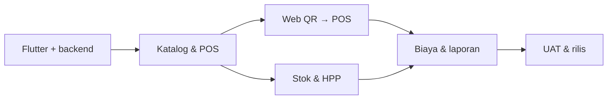

# SPRINTS.md
## Smart POS Waroeng MeJeng Kampoeng | Build Plan v2.1 · MVP Product Tanpa ML

| Metadata | Nilai |
|---|---|
| Tanggal | 26 Oktober 2026 |
| Status | **TODO**. Seluruh pekerjaan di bawah belum diklaim selesai |
| Spesifikasi induk | `PRD.md` versi 2.1 |
| Produk | Satu aplikasi Flutter untuk **satu operator** + satu web QR pelanggan |
| UI | Tablet Android landscape prioritas, responsif HP, **brand `#930031`** dan Material Icons tanpa emoji |
| Backend | Supabase Auth, PostgreSQL, API bisnis terproteksi, Realtime (opsional untuk notifikasi QR), tanpa ML/AI pada MVP |
| Ritme rencana | Sprint 1–6 masing-masing target 1–2 pekan (disesuaikan kapasitas developer); tidak ada sprint ML pada MVP |

> **Fokus dokumen ini adalah membangun aplikasi.** Tidak ada Sprint Observasi, tidak ada roadmap multi-tenant, tidak ada fitur Dapur, dan tidak ada halaman Pesanan. Setiap sprint berisi task coding, struktur data, integrasi, test, dan output yang dapat dijalankan. Bila ada data bisnis yang belum diketahui, developer memakai fixture **berlabel SIMULASI** dan mencatat konfigurasi yang harus diisi operator, bukan menghentikan pembangunan untuk kegiatan observasi panjang.

---

# 1. Prinsip Arsitektur yang Tidak Boleh Dilanggar

- **Hanya satu akun operator internal**, tidak perlu `employees`, `staff_roles`, halaman shift antarstaf, `kitchen_tickets`, `branches`, `tenants`, atau modul langganan.
- **Halaman POS adalah satu-satunya titik operasional transaksi**: menu → keranjang → QR Masuk → bayar → struk. Tidak buat `OrdersPage` dan `KitchenPage`.
- Web QR dapat mengirim **draft keranjang**, bukan transaksi lunas. Draft muncul sebagai panel/tab **QR Masuk dalam POS**.
- `sales` berbeda dari `qr_drafts`: QR draft belum masuk omzet maupun pengurangan stok.
- Final checkout divalidasi di server dan idempotent, atomik untuk sale + payment + stock ledger.
- Harga dan modifier disimpan sebagai snapshot setiap item sale. Penjualan historis tidak terpengaruh edit menu.
- Biaya energi dan HPP pakai perhitungan deterministik, bukan label AI.
- **Tidak ada ML pada MVP**: jangan membuat `ml_api`, pipeline/model, endpoint forecast, dashboard AI, atau fixture prediksi. Analytics hanya data aktual. Usulan ML dipisah dari backlog rilis.

## 1.1 Prioritas

`P0` = rilis inti, `P1` = pengayaan, `P2` = opsional terpisah. Jika suatu P1 belum bisa diuji (printer atau offline), jangan mengklaim fitur selesai.

## 1.2 Status tiket

`TODO → IN_PROGRESS → IN_REVIEW → IN_TEST → DONE` atau `BLOCKED` bila dependensi belum terpenuhi.

## 1.3 Definition of Done umum

- [ ] Kode, migrasi, dan test tersimpan di Git; build clean.
- [ ] Lint/format/unit test serta integration test yang relevan lulus.
- [ ] Loading, empty, invalid, retry, dan pesan error telah ditangani.
- [ ] Tampilan diuji pada **Android tablet landscape** dan HP (emulator/perangkat); mengikuti struktur/alur `index.html`, warna `#930031`, ikon `Icons.*` Flutter, tanpa emoji atau UI generik.
- [ ] Backend menolak input total/harga ilegal dan tidak mengandalkan validasi frontend saja.
- [ ] State yang melibatkan uang/stok memiliki log/snapshot dan tidak double-submit.
- [ ] Dokumentasi kontrak API dan petunjuk jalankan app diperbarui.
- [ ] Screenshot atau video demo serta hasil tes dicatat di `docs/sprint-log.md`.
- [ ] Tidak ada tautan/button mati yang dipresentasikan sebagai fitur selesai.

---

# 2. Roadmap Eksekusi Ringkas

| Sprint | Tema coding | Target demo akhir | Keluarannya |
|---|---|---|---|
| **01** | Project scaffold, design system, database, auth | Buka aplikasi Flutter, login satu operator, lihat dashboard dan navigasi | Flutter + Vue + Supabase starter |
| **02** | Katalog, adjustable pricing, POS, checkout | Tambah menu, ubah harga, bayar tunai, lihat struk | Kasir siap transaksi manual |
| **03** | QR pelanggan di dalam POS | Scan QR HP → kirim keranjang → muncul di panel QR Masuk POS → bayar | Alur QR tanpa Pesanan/Dapur |
| **04** | Inventory, resep, pembelian, HPP | Stok otomatis dari transaksi final, pembelian dan biaya bahan | Ledger bahan + HPP |
| **05** | Listrik, LPG, air, overhead, kas, laporan | Hitung biaya operasi dan rekonsiliasi kas/penjualan | Modul biaya dan laporan |
| **06** | Refine UX, security, performance, release | Uji full flow pada tablet, recover/backup, build APK | Build kandidat rilis dan UAT |



---

# 3. Sprint 01 – Kerangka Aplikasi dan Database

**Goal:** proyek dijalankan dari repository tanpa setup manual yang misterius. Antarmuka internal hanya satu operator.

| ID | Prioritas | Implementasi langsung | Acceptance criteria | Status |
|---|---|---|---|---|
| S01-01 | P0 | Buat monorepo Flutter (`apps/pos_flutter`), web Vue (`apps/qr_web`), `supabase/migrations`, dan API bisnis | `flutter run` serta `npm run dev` jalan dengan `.env.example` | **PARTIAL** — `npm run dev` terverifikasi (HTTP 200), `flutter build apk --debug` lulus (APK 147,6 MB); `flutter run` butuh perangkat fisik yang belum tersedia |
| S01-02 | P0 | Flutter design tokens: **primary `#930031`**, typography, spacing, card, button, modal, empty/loading/error, Material Icons; animasi transisi yang fungsional dan aksesibel | Widget story/demo untuk tiap komponen | **DONE** — `test/app/theme_test.dart` memastikan brand; komponen diuji di `test/app/shell_test.dart` |
| S01-03 | P0 | Router dan shell tablet: sidebar landscape, mobile bottom navigation; halaman `Dashboard`, `POS`, `Menu`, `QR`, `Stok`, `Resep`, `Pembelian`, `Biaya`, `Energi`, `Kas`, `Riwayat`, `Laporan`, `Pengaturan` | Tidak ada `Dapur`, `Pesanan`, atau `Pegawai` | **DONE** — 13 halaman jujur (empty state menunggu sprint berikutnya), teruji di shell_test |
| S01-04 | P0 | Integrasi Supabase Auth **satu akun operator**: login, logout, refresh session | Publik tidak bisa mengakses halaman internal | **DONE** — login/logout/login_page_test lulus; akun `operator@mejeng.id` dibuat & diuji via REST |
| S01-05 | P0 | Migrasi awal: business_settings, product categories, products, modifiers, price_history, tables | SQL migration + constraint dan seed dummy dev | **DONE** — 4 migrasi diterapkan ke Supabase asli; seed `[DEMO]` lulus |
| S01-06 | P0 | RLS & API authorization: private operator; public hanya membaca menu aktif / kirim QR draft melalui endpoint aman | Test akses tanpa token/operator invalid ditolak | **DONE** — anon kembalikan `[]`/401, token salah → `invalid_table_token`, token valid → menu |
| S01-07 | P0 | State management (Riverpod), shared DTO, error mapper, HTTP client, WIB/IDR utilities | Unit test parse, money format, state loading | **DONE** — `formatters_test` (19 asersi) + `error_mapper_test` lulus |
| S01-08 | P0 | CI GitHub: Flutter analyze/test, Vue lint/build, migration test; format precommit | Pipeline lulus dan README dapat direproduksi | **PARTIAL** — `.github/workflows/ci.yml` ditulis (Flutter, Vue, migrasi ke Postgres polos); belum dijalankan di GitHub (belum ada remote) |

**Demo:** login → dashboard UI → POS kosong → navigasi semua menu tanpa crash. Gunakan fixture `DEMO`, belum mengklaim transaksi nyata.

**Gate S01:**
- [x] User flow internal memakai **1 identitas operator**, bukan role switch. (akun tunggal `operator@mejeng.id`, tanpa tabel role/pegawai)
- [x] QR publik dan operator memiliki jalur akses yang berbeda. (anon hanya `get_public_menu`; data privat tertutup RLS — diuji langsung ke Supabase)
- [ ] Build Android debug berhasil, layout tablet/HP layak navigasi. (**sebagian** — `flutter build apk --debug` menghasilkan APK; instalasi & navigasi di tablet/HP sungguhan masih menunggu perangkat)

---

# 4. Sprint 02 – Katalog dan Kasir POS (End-to-End)

**Goal:** kasir menyelesaikan transaksi tanpa QR menggunakan Flutter tablet. Fokus paling penting dari produk.

| ID | Prioritas | Implementasi langsung | Acceptance criteria |
|---|---|---|---|
| S02-01 | P0 | Form kategori, menu, harga, foto, tersedia/habis, arsip; validation + upload image | Item baru tampil di POS, arsip tidak menghapus histori |
| S02-02 | P0 | Varian, topping, harga tambahan, catatan menu, aturan minimal/maksimal | Total per item tepat dalam test modifier |
| S02-03 | P0 | Harga adjustable + `price_history`; perubahan harga aktif dan snapshot | Transaksi terdahulu tak berubah setelah edit |
| S02-04 | P0 | UI `Kasir POS` tablet: pencarian, kategori, grid menu, tambah item, qty ±, hapus, catatan, pilihan makan di tempat/takeaway | Semua dilakukan dalam satu layar tanpa menu Pesanan |
| S02-05 | P0 | `sales/quote` kalkulator server: subtotal, diskon, pajak/layanan konfigurabel, total | Test 50+ skenario uang integer & rounding |
| S02-06 | P0 | Pembayaran dari POS (sheet/modal): tunai, transfer/QRIS manual, nominal dibayar, kembalian | Saldo dan kembalian tidak negatif/inkonsisten |
| S02-07 | P0 | DB `sales`, `sale_items`, `payments`, `refunds`, `audit_events` + atomic checkout/idempotency | Double-click key sama menghasilkan **satu** sale |
| S02-08 | P0 | Struk digital dan halaman Riwayat Penjualan; search/filter | Harga snapshot tetap, struk cocok dengan pembayaran |
| S02-09 | P0 | Dashboard omzet dan jumlah transaksi dari sale final, bukan keranjang | Angka dashboard cocok query SQL |
| S02-10 | P0 | Unit, integration, widget, E2E Flutter pembayaran dan price change | UAT-01, UAT-04, UAT-05 lulus |

**Demo:** operator membuat menu dummy → mengganti harga → memilih dua makanan dan minuman → bayar tunai → melihat kembalian → struk → histori dan dashboard ter-update. **Tidak ada tahap penerimaan dapur**.

**Gate S02:**
- [ ] Checkout memang hanya dari POS.
- [ ] Uang/tarif ditetapkan di server; mobile tidak dapat memalsukan total.
- [ ] Refund/void dicatat, tidak menghapus uang historis.
- [ ] Button masuk POS dan back navigation berfungsi di tablet/HP.

---

# 5. Sprint 03 – QR Ordering Langsung ke Layar POS

**Goal:** QR meja tetap berguna meskipun hanya satu operator; **tanpa halaman Pesanan**.

| ID | Prioritas | Implementasi langsung | Acceptance criteria |
|---|---|---|---|
| S03-01 | P0 | Editor nomor meja, generate token opaque, rotasi token, URL QR | QR lama invalid setelah rotasi |
| S03-02 | P0 | Vue web pelanggan: daftar menu, foto, varian, topping, qty, keranjang, identitas meja | Responsif 360px; pelanggan tidak login |
| S03-03 | P0 | `POST /public/qr-drafts`: validasi token, katalog aktif, qty, rate limit, idempotency | QR hanya menghasilkan draft sementara, bukan sale |
| S03-04 | P0 | `qr_drafts`, `qr_draft_items`: `PENDING/CLAIMED/EXPIRED/CANCELLED`, expiring link | Duplicate submit tidak menciptakan banyak draft |
| S03-05 | P0 | Panel **QR Masuk** di dalam UI `Kasir POS`: badge count dan kartu ringkas meja, item, waktu | Panel ada dalam POS, bukan route/tab navigasi tersendiri |
| S03-06 | P0 | Aksi `Ambil ke Kasir`: validasi ulang harga & item, isi keranjang aktif; cegah silent merge dengan keranjang lama | Checkout tetap memakai S02, draft ditandai CLAIMED |
| S03-07 | P0 | Realtime event/refresh polling fallback saat notifikasi gagal | Draft yang belum diambil tetap terlihat setelah refresh |
| S03-08 | P0 | Halaman sukses pelanggan: nomor referensi, instruksi tunggu kasir; **tanpa status dapur/tracking** | Tidak ada timeline preparing/ready/served |
| S03-09 | P0 | E2E 2 HP submit serentak → POS pilih salah satu → bayar | Draft terisolasi, item pelanggan tidak tercampur |

**Demo:** dari mode QR HP pilih Ayam Kremes + Teh Es → kirim → pindah ke **Kasir POS** → `QR Masuk (1)` → `Ambil ke Kasir` → tunai → struk. Operator sendirian mengurus prosesnya.

**Gate S03:**
- [ ] Customer tidak bisa mengakses kas, bahan, HPP, atau laporan.
- [ ] Draft QR belum masuk omzet/stock ledger.
- [ ] Tidak ada layar kitchen/order management tersembunyi pada aplikasi utama.
- [ ] Harga berubah antara submit dan ambil ditampilkan sebagai konflik yang harus disetujui operator.

---

# 6. Sprint 04 – Stok, Pembelian, Resep, HPP

**Goal:** penjualan final terhubung dengan perhitungan stok dan biaya resep dengan log mutasi.

| ID | Prioritas | Implementasi langsung | Acceptance criteria |
|---|---|---|---|
| S04-01 | P0 | Migrasi master `ingredients` + decimal qty, satuan dasar, minimum stock, unit cost | Kg↔g; L↔ml lulus test satuan |
| S04-02 | P0 | UI `Stok Bahan`: list, cari, status minimum, tambah/ubah, koreksi stok dengan alasan | Perubahan menulis ledger |
| S04-03 | P0 | Form `Pembelian`: supplier opsional, bahan, qty, harga, tanggal, status received | Saldo bertambah tepat sekali saat diterima |
| S04-04 | P0 | UI `Resep & HPP`: pilih menu, tambah bahan, takaran, yield per batch, biaya bahan per porsi | Formula sesuai versi resep dan unit cost |
| S04-05 | P0 | Database recipe_versions/items dan append-only stock_movements | Histori biaya/resep bisa ditelusuri |
| S04-06 | P0 | Integrasi checkout POS → pemakaian bahan tepat sekali saat sale final; pembelian/waste diposting terpisah | Dua retry checkout tak menggandakan bahan terpakai |
| S04-07 | P0 | Pengecualian bahan kosong, resep belum ada, dan batch siap jual (gorengan) | Tidak otomatis mengklaim stok akurat untuk menu tanpa resep |
| S04-08 | P0 | Laporan margin bahan per menu, stok minimum, mutasi terakhir | Margin hanya memakai komponen yang ada datanya |
| S04-09 | P0 | Unit/integration tests concurrency, rollback dan double-post | UAT-06–08 lulus |

**Keputusan desain awal:** untuk menu dibuat saat dipesan, konsumsi resep dicatat saat checkout final (model POS sederhana); untuk produk gorengan yang dibuat per batch gunakan produksi batch agar tidak mengurangi bahan dua kali. Bila pemakaian bahan nyata berbeda, koreksi dicatat eksplisit oleh operator.

---

# 7. Sprint 05 – Biaya Operasional, Kalkulator, Kas dan Laporan

**Goal:** memperkirakan biaya produksi dan profitabilitas tanpa menyamakan biaya estimasi dengan tagihan nyata.

| ID | Prioritas | Implementasi langsung | Acceptance criteria |
|---|---|---|---|
| S05-01 | P0 | UI `Kalkulator Energi`: daya W, jam, load factor, tarif Rp/kWh, porsi; LPG isi ulang & jam efektif | Rumus kWh/LPG benar dan biaya/porsi valid |
| S05-02 | P0 | UI dan tabel `equipment`, `energy_estimates`, `expenses`, `cost_allocations` | Data asumsi tidak otomatis menjadi expense aktual |
| S05-03 | P0 | Input pengeluaran listrik, LPG, air, kemasan, sewa, internet, lain-lain; bukti opsional | Jenis `ESTIMATED` / `ACTUAL` terlihat di list/laporan |
| S05-04 | P0 | Cegah double counting alokasi biaya batch dan overhead | Total alokasi ≤ sumber biaya; laporan reconcile |
| S05-05 | P0 | Modul `Kas Shift`: mulai shift, kas awal, transaksi cash, pengeluaran kas, uang aktual, selisih | Non-tunai tidak masuk kas fisik |
| S05-06 | P0 | Dashboard detail: omzet, transaksi final, biaya langsung/HPP, overhead, estimasi hasil operasi | Semua nilai ditelusuri ke catatan |
| S05-07 | P0 | Halaman `Laporan`: filter tanggal, grafik tren, menu terlaris, biaya per kategori, transaksi | Nilai cocok dengan DB, refund mengurangi net sales |
| S05-08 | P1 | Ekspor CSV yang valid dan dapat dibuka, PDF/XLSX kemudian | Format Rupiah/jumlah tidak berubah makna |
| S05-09 | P0 | Unit & integrasi test alokasi listrik, tarif input, biaya aktual vs estimasi, kas shift | UAT-09–11 lulus |

**Demo:** input 800 W × 3 jam × load 80% × Rp1.500/kWh → tampil estimasi kWh/biaya; simpan expense **Estimasi** → bandingkan biaya aktual → lihat HPP dan laporan → tutup kas.

---

# 8. Sprint 06 – Penyempurnaan, QA, dan APK Rilis

**Goal:** menyempurnakan aplikasi operasional, bukan menambah halaman yang tidak dibutuhkan.

| ID | Prioritas | Implementasi langsung | Acceptance criteria |
|---|---|---|---|
| S06-01 | P0 | Audit setiap page Flutter: layout tablet landscape, HP portrait, state kosong, keyboard, snackbar, modal, tab | Navigasi lengkap, tanpa overflow |
| S06-02 | P0 | Uji QR submit online, retry, idempotency, item habis/harga berubah | Tidak ada sale/draft ganda akibat tombol berulang |
| S06-03 | P0 | Uji keamanan API/RLS, input injection, public QR rate limit, token rotate, secret scanning | Akses publik ke data internal = ditolak |
| S06-04 | P0 | Error logging, crash report (tanpa data sensitif), backup DB, latihan restore | Restore terbukti di staging |
| S06-05 | P0 | End-to-end smoke test `POS langsung` dan `QR → POS → bayar`, stok, laporan | Semua skenario kritis lulus pada tablet target |
| S06-06 | P0 | Kinerja: profil list panjang, transaksi, loading skeleton, cache aman, fetch efisien | Hasil pengukuran dicatat; UI tidak freeze |
| S06-07 | P1 | Struk printer ESC/POS atau Bluetooth **setelah tipe perangkat dipastikan** | Cetak/cetak ulang tidak menambah sale |
| S06-08 | P1 | Offline operator outbox SQLite (hanya jika dicakup) | Konflik dan unsynced terlihat; transaksi tidak silent loss |
| S06-09 | P0 | Build Android release, versioning, signing aman, migration plan, rollback procedure | APK/AAB dapat dipasang, tidak menyimpan secret server |
| S06-10 | P0 | Checklist UAT/SOP ringan dan serah terima operator | Operator dapat menyelesaikan transaksi tanpa bantuan developer |

**Gate rilis wajib:**
- [ ] Tidak ada navigasi/fitur `Dapur`, `Pesanan`, `Pegawai`, `Multi Cabang`, `SaaS`.
- [ ] Setiap tombol checkout dan setiap perubahan uang/stok aman terhadap retry.
- [ ] Web QR menampilkan keberhasilan kirim draft, bukan menyatakan sudah dibayar.
- [ ] Kas dan omzet benar-benar berdasarkan sale final, bukan data cart/QR pending.
- [ ] Backup/restore, autentikasi, dan pengujian manual tablet lulus.
- [ ] Keterbatasan printer/offline/PSP dinyatakan jelas jika belum diuji.

---

# 9. Fitur Post-MVP yang **Tidak Dikerjakan**

Jangan melanjutkan Sprint 07 atau proyek Machine Learning selama pembangunan MVP. Yang dikerjakan hanya Sprint 01 sampai Sprint 06 dan perbaikan hasil UAT. Tidak boleh membuat model, FastAPI inference, tabel forecast, UI AI Insights, atau hasil prediksi demo. Usulan forecasting baru dibahas dalam PRD dan backlog terpisah **setelah rilis MVP dan data historis memadai**.

Data penjualan riil, histori harga, resep, dan waktu transaksi tetap dicatat dengan benar karena memang dibutuhkan oleh laporan aplikasi, bukan sebagai pekerjaan ML tambahan.

# 10. Kontrak Halaman dan File yang Direkomendasikan

Struktur ini adalah target refactor, bukan klaim file sudah dibuat:

```text
waroeng-mejeng-pos/
├── PRD.md
├── Sprints.md
├── index.html                         # MOCKUP interaktif, bukan aplikasi produksi
├── README.md
├── apps/
│   ├── pos_flutter/
│   │   └── lib/
│   │       ├── app/{router,theme,widgets}/
│   │       ├── features/
│   │       │   ├── dashboard/
│   │       │   ├── pos/             # termasuk QR Masuk + pembayaran
│   │       │   ├── catalog/
│   │       │   ├── tables_qr/
│   │       │   ├── inventory/
│   │       │   ├── recipes_hpp/
│   │       │   ├── purchases/
│   │       │   ├── operating_cost/
│   │       │   ├── energy_calculator/
│   │       │   ├── cash_shift/
│   │       │   ├── sales_history/
│   │       │   ├── reports/
│   │       └── core/{models,api,storage,utils}/
│   └── qr_web/
│       └── src/{pages,components,api}/
├── services/
│   ├── business_api/
├── supabase/{migrations,seed}/
├── tests/{unit,integration,e2e}/
└── docs/{architecture,api-contracts,sprint-log,release-notes}.md
```

Tidak membuat `features/orders`, `features/kitchen`, `features/employees`, atau `features/tenant`.

# 11. Integrasi CRUD dan UI Prioritas

| Fitur | Flutter page | Backend entity | UI inti |
|---|---|---|---|
| Dashboard | `dashboard_page` | `sales`, `expenses`, `ingredients` | KPI omzet, stok rendah, QR masuk |
| POS | `pos_page` | `sales`, `payments`, `qr_drafts` | 2 kolom tablet: menu kiri, keranjang kanan + QR Masuk |
| Pricing | `catalog_page` | `products`, `price_history` | Form harga, modifier, tombol tersedia/habis |
| Meja & QR | `qr_settings_page` | `dining_tables` | Grid meja + generate/rotate QR |
| Stok | `inventory_page` | `ingredients`, `stock_movements` | Mutasi, threshold, pencarian |
| Resep | `recipe_page` | `recipe_versions`, `recipe_items` | Edit takaran/yield + HPP hasil |
| Pembelian | `purchases_page` | `purchases` | Form terima bahan, total biaya |
| Biaya | `expenses_page` | `expenses`, `cost_allocations` | Input actual/estimate dan catatan |
| Energi | `energy_page` | `energy_estimates` | Kalkulator realtime + simpan |
| Kas | `cash_page` | `cash_shifts`, `payments` | Buka/tutup shift, selisih |
| Riwayat | `sales_history_page` | `sales`, `refunds` | Filter, detail, struk dan refund |
| Laporan | `reports_page` | summary SQL | Grafik, laporan biaya dan margin |
| Pengaturan | `settings_page` | `business_settings` | Nama, lokasi, tarif dan preferensi |

# 12. Template Issue Pengembangan

```md
## [S02-04] Implementasi POS tablet
- Status: TODO
- Prioritas: P0
- PRD: SCR-02, FR-07
- Dep: S02-01, S02-03
- Berkas yang ditambahkan/diubah:
- Detail implementasi:
  - [ ] Grid katalog tablet + responsive mobile
  - [ ] Cart add, qty, remove, modifier
  - [ ] Total perkiraan dan API quote
  - [ ] Empty/loading/error state
  - [ ] Test unit/widget/E2E
- Acceptance criteria:
  - [ ] Kasir dapat checkout tanpa membuka halaman pesanan
  - [ ] Tombol tidak memicu duplicate submit
- Bukti: commit URL / test log / screenshot
- Reviewer:
```

# 13. Catatan Progres dan Change Log

| Tanggal | Sprint | Tiket | Status | Implementasi/commit | Hasil pengujian | Kendala |
|---|---|---|---|---|---|---|
| 26 Okt 2026 | 01 | S01-02, S01-03, S01-04, S01-05, S01-06, S01-07 | DONE | `a039446` scaffold + shell + auth + migrasi + RLS | `flutter analyze` 0 issue; `flutter test` 19/19; REST Supabase anon vs operator lulus | - |
| 26 Okt 2026 | 01 | S01-01, S01-08 | PARTIAL | monorepo + CI workflow | `npm run build` lulus; `npm run dev` HTTP 200 | Belum ada remote Git/GitHub Actions; `flutter run` butuh perangkat |

**Change Log v2.0:**
- Menghapus Sprint 0 Observasi dan mengganti Sprint 01 dengan setup serta pembangunan dasar.
- Menghapus pembangunan Kitchen, Order Management, Employee Roles, Multi-Tenant.
- Menggabungkan semua kerja operasional ke **Kasir POS**, termasuk notifikasi `QR Masuk`.
- Menjaga fungsi keuangan, inventaris, utilitas, dan AI sesuai PRD v2.0.
- Mengubah keberhasilan sprint menjadi deliverable aplikasi dan tes, bukan daftar kegiatan lapangan.

## Keputusan UI dan Product MVP (per 26 Oktober 2026)

- **Warna primer `#930031`**. Jangan gunakan palet hijau lama `index.html` sebagai brand primer.
- **Tanpa emoji dan ilustrasi generik** pada seluruh aplikasi Flutter. Gunakan ikon Material bawaan Flutter dan foto produk yang sah.
- `index.html` merupakan prototipe perilaku dan layout. Implementasi Flutter wajib mempunyai state, validasi, loading, empty/error, animation feedback, dan data sungguhan.
- **MVP = Sprint 01–06 saja**, tanpa halaman, model, pipeline, API, dependensi, dan klaim AI/ML.
- Buktikan setiap sprint menggunakan build dan tes yang benar; checklist tidak boleh diubah menjadi DONE jika belum dikerjakan.
